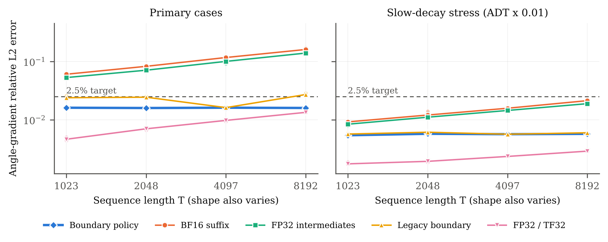

# Boundary Evaluation of Rotary State-Space Gradients in Mixed Precision

Code, raw data, and proofs for the preprint *Boundary Evaluation of Rotary State-Space Gradients in Mixed Precision* (Triphop Mahithitarmmatorn, 2026). The arXiv link will be added after announcement.

**Problem.** Mamba-3–style rotary state-space layers apply rotations through cumulative angles, so the gradient of each angle increment is a suffix sum of per-token terms that nearly cancel. In BF16 the error of this suffix sum grows roughly as √T. A more accurate accumulator does not help.

**Method.** At every chunk boundary the suffix sum equals a contraction ⟨P_b, X_b J_i⟩ of the *folded* trapezoidal state with its adjoint, plus a terminal term κ. κ is exactly zero for output-only losses. Only intra-chunk local terms are summed explicitly.

**Result (one RTX 3080, frozen 24-case protocol).** The angle-gradient error stays at about 1.6% from T = 1023 to 8192 (log–log slope 0.00). BF16 suffix sums grow from 6% to 16% (slope 0.49) over the same range. The median overhead over BF16 is about 4% under CUDA-graph replay. FP32 variants remain more accurate. See `paper/main.pdf` §VII for limitations.



## Repository layout

```
.
├── paper/               arXiv source (main.tex, content.tex, results.tex, images/) and main.pdf
├── kernels/             modified mamba_ssm Triton source trees, one per method family
│   ├── terminal_fused/          BF16 suffix sum and legacy boundary (mode switch)
│   ├── boundary_policy/         proposed method: boundary buffer + metadata policy (κ = 0 when no final states)
│   ├── midprecision_baseline/   FP32 intermediate Q/K gradients
│   ├── tf32_baseline/           FP32 storage, single-pass TF32 dots
│   └── fp32_tuned/              FP32 storage, tf32x3 dots, backward autotuning
├── src/                 shared helpers: m3env (load a kernel tree), input generators (m1017/),
│                        direct local-coordinate FP32 adjoint in Triton (local_rotation_triton*.py)
├── reference/           FP64 references and CPU correctness checks (no GPU needed)
├── experiments/         GPU validation, the frozen final study, memory/complete-primitive timing
├── analysis/            summaries, figures, and an independent recomputation of every paper number
├── results/             raw and derived data (see results/README.md)
├── protocols/           frozen protocols; ITERATION03_FINAL_PROTOCOL.md is hashed into every final-study result
├── notes/               derivation notes, claim-evidence map, study reports (some in Thai)
├── verification/        independent FP64 re-derivation, BF16 mechanism emulation, Lean 4 proofs (lean/)
├── paths.py             single definition of the layout; every script imports it
└── reproduce.py         entry point
```

## Quick start

CPU checks need only NumPy and PyTorch. The commands below can run from any working directory.

```bash
python -m venv .venv && source .venv/bin/activate      # Windows: .venv\Scripts\activate
pip install -r requirements-cpu.txt
python reproduce.py --quick      # identity, global/local adjoints, checkpoint replay  (~20 s)
python reproduce.py --verify     # recompute every number in the paper from results/; independent FP64 checks
python reproduce.py --figures    # regenerate summaries and figures from raw results
```

GPU modes were run on Windows 11 with an RTX 3080 (sm86), PyTorch 2.10.0+cu128 and Triton-Windows 3.6.0. Install the CUDA build of PyTorch first, then `requirements-gpu-windows.txt`. Linux has not been tested.

```bash
python reproduce.py --gpu-check   # local-adjoint and boundary-policy validation on small cases
python reproduce.py --gpu-study   # frozen 24-case x 7-method study -> results/final_study/, then analysis
python reproduce.py --resources   # warmed memory and complete-primitive timing -> results/resource_e2e/
```

Rerunning `--gpu-study` overwrites `results/final_study/`. Commit or copy the delivered results first if you want to compare against them. Timings depend on the GPU, the driver and clock behaviour, and the delivered runs did not lock clocks.

## Lean proofs

```bash
cd verification/lean
lake exe cache get      # optional: fetch prebuilt Mathlib
lake build              # checks BoundaryProof.lean (22 theorems, no sorry)
lake env lean CheckAxioms.lean
```

The proofs cover the equivariance induction behind the boundary identity, the suffix chain rule, the chunk split, the error inequalities, and the local-coordinate change of variables. They do not cover floating-point rounding models or the derivative of the rotation, which enters as a hypothesis. See the header of `BoundaryProof.lean`.

## Scope

The method covers SISO rotary recurrences with scalar decay and commuting pair rotations. MIMO and variable-length packing fall back to the existing path. Results come from one GPU model and measure gradient error of a numerical primitive, not training quality. Grouped-query atomic reductions make some K gradients non-deterministic across repeats.

## License

- Code is licensed under Apache-2.0 (`LICENSE`). The trees in `kernels/` are modified from [state-spaces/mamba](https://github.com/state-spaces/mamba) (Apache-2.0); see `NOTICE.md`.
- The paper text, figures and result data are licensed under CC BY 4.0.

## Citation

See `CITATION.cff`. The arXiv identifier will be added once the preprint is announced.
